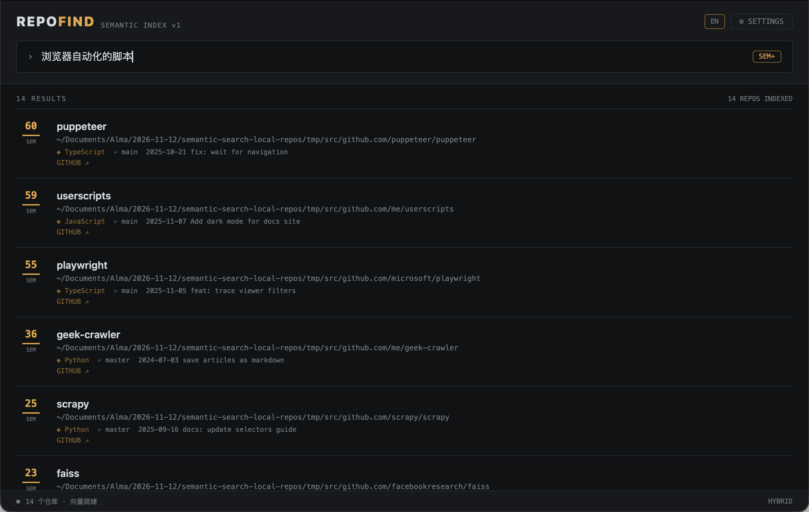

# RepoFind

**用自然语言搜索你本地的 git 仓库。**

本地 clone 了几百个仓库，忘了名字、忘了放哪？RepoFind 给你建语义索引——输入"浏览器自动化的脚本"，它找到 `tampermonkey-scripts`；输入"向量检索"，它找到相关的推荐系统 / QA / LTR 项目。中文、英文、中英混合都可以。



## 工作原理

```
┌─────────────┐   scan    ┌──────────────┐   embed   ┌─────────────┐
│ 本地 git 仓库 │ ────────▶ │ index.json   │ ────────▶ │ vectors.json │
│ ~/work/...   │           │ README+元数据 │           │ bge-m3 向量   │
└─────────────┘           └──────────────┘           └─────────────┘
                                                           │
              ┌────────────────────────────────────────────┤
              ▼                                            ▼
        ┌───────────┐   HTTP :8765   ┌──────────────────────┐
        │ CLI 检索   │ ◀────────────  │ server.py (可选)      │
        │ repofind  │                │ nsh 原生应用 / Web UI │
        └───────────┘                └──────────────────────┘
```

- **索引**：遍历 git 仓库，提取 README、语言、分支、远端、最近提交
- **检索**：混合排序 = `0.6 × 语义(bge-m3 余弦) + 0.4 × 词法(TF-IDF)`
  - 语义管"意思对了"，词法管"名字精确命中不被稀释"
  - 中文按 bigram 分词，路径段单独加权
- **零 Python 依赖**：CLI 和 server 都是纯标准库

## 快速开始

### 1. 安装

```bash
git clone https://github.com/ahjdzx/repofind.git
cd repofind
```

需要 Python 3.10+，无第三方依赖。

### 2. 配置 embedding API

任意 OpenAI 兼容的 embeddings 接口都可以（也支持 [SiliconFlow](https://siliconflow.cn) 免费的 `BAAI/bge-m3`）：

```bash
export REPOFIND_EMBED_KEY="sk-..."                    # API key
export REPOFIND_EMBED_URL="https://api.siliconflow.cn/v1"   # 默认 openai
export REPOFIND_EMBED_MODEL="BAAI/bge-m3"             # 默认 bge-m3
```

### 3. 建索引

```bash
python3 repofind.py scan     # 扫描仓库（默认 ~/work ~/Projects ~/code ~/dev ~/Documents）
python3 repofind.py embed    # 生成向量（323 个仓库约 5 秒）
```

### 4. 搜索

**CLI：**

```bash
python3 repofind.py search "推荐系统"
python3 repofind.py search "rust gui" -n 5
python3 repofind.py search "kube" --no-semantic   # 纯词法，不调 API
python3 repofind.py list
python3 repofind.py path "tuhuyun"
```

**原生应用（可选，需要 [nsh](https://nsh.dev) CLI）：**

```bash
brew install longbridge/tap/nsh
python3 server.py &                 # 搜索服务
nsh run app --target macos          # 原生 macOS 窗口
nsh run app --target web            # 或浏览器
```

应用支持自然语言搜索、语言标签、点按复制路径、GitHub 远端直达。

## 建议加个 alias

```bash
echo 'alias rf="python3 /path/to/repofind/repofind.py"' >> ~/.zshrc
rf search "那个我忘了名字的仓库"
```

## 配置

| 环境变量 | 默认值 | 说明 |
| --- | --- | --- |
| `REPOFIND_EMBED_KEY` | / | API key（必填才能跑 embed/语义检索） |
| `REPOFIND_EMBED_URL` | `https://api.openai.com/v1` | OpenAI 兼容接口地址 |
| `REPOFIND_EMBED_MODEL` | `bge-m3` | embedding 模型名 |
| `REPOFIND_EMBED_KEY` 备选 | `OPENAI_API_KEY` | 未设 REPOFIND_EMBED_KEY 时回退 |

扫描根目录用 `-r` 覆盖：`python3 repofind.py scan -r ~/code ~/src`

## Roadmap

- [x] TF-IDF 词法检索（中英混合）
- [x] bge-m3 / OpenAI 兼容 embedding 语义检索
- [x] 混合排序 + 模型指纹（换模型自动提示重建）
- [x] nsh 原生应用（macOS / Web）
- [ ] 增量扫描（只更新变化的仓库）
- [ ] 文件名/代码片段级索引
- [ ] fzf 交互模式
- [ ] Raycast 扩展

## License

[MIT](LICENSE)
