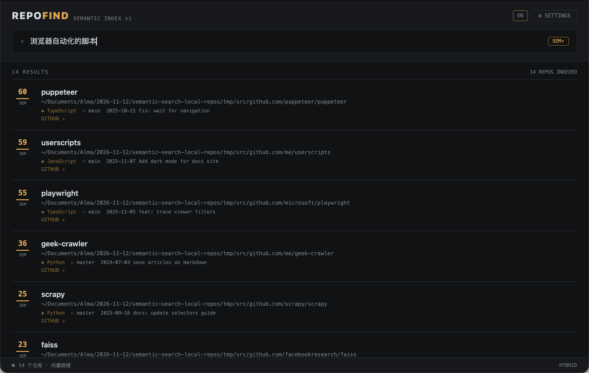

# RepoFind

[English](README.md) | **简体中文**

**用自然语言搜索你本地的 git 仓库。** 一个纯客户端桌面应用 — 无 server、无 Python、无 Node。

本地 clone 了几百个仓库，忘了名字、忘了放哪？RepoFind 给它们建语义索引——输入"浏览器自动化的脚本"，排在前面的就是 puppeteer、你的油猴脚本和 playwright，哪怕仓库名和 README 里一个字都对不上。中文、英文、中英混合都可以。



<sub>截图用的是一组演示仓库。</sub>

## 特点

- **纯客户端** — 基于 [nsh](https://nsh.dev) (Native Shell)：扫描文件系统、建索引、跑 embedding 模型全在应用内完成
- **混合检索** — `0.6 × 语义(余弦相似度) + 0.4 × 词法(TF-IDF)`，语义管"意思对了"，词法保"名字精确命中不被稀释"
- **中英混合分词** — 中文 bigram、英文驼峰拆分、路径段单独加权
- **三种向量来源** — 应用内置的本地模型（默认 `multilingual-e5-small`，下载一次后完全离线）、本机已经在跑的 embedding 服务（LM Studio、llama.cpp、Ollama），或任意 OpenAI 兼容接口
- **总览**（首页）— 按主题、语言、最近变动、本机提交、来源、归属统计仓库，点任意一项筛选，搜索也只在筛出来的仓库里进行
- **直接打开** — 每条结果都能在 Finder（资源管理器 / 文件管理器）或终端里打开；macOS 上可在设置里选 Terminal、iTerm、Ghostty、Warp 等
- **增量重建** — 重新建索引时，只有文本变了的仓库才重新生成向量
- **零 git 依赖** — 分支/远端/最近提交直接读 `.git` 内部文件（HEAD / config / logs/HEAD），不调 git 进程
- **中英双语界面** — 右上角一键切换

## 下载

从 [Releases](https://github.com/ahjdzx/repofind/releases) 下载对应平台的文件：

| 平台 | 文件 | 要求 |
| --- | --- | --- |
| macOS，Apple 芯片 | `RepoFind-<版本>-macos-arm64.zip` | macOS 14+ |
| macOS，Intel | `RepoFind-<版本>-macos-x86_64.zip` | macOS 14+ |
| Linux | `RepoFind-<版本>-linux-x86_64.tar.gz` / `-linux-arm64.tar.gz` | glibc 2.39+、GTK 4.14+（Ubuntu 24.04 及以后） |
| Windows | `RepoFind-<版本>-windows-x86_64.zip` | Windows 10 1809+ |

- **macOS**：解压后把 `RepoFind.app` 拖进"应用程序"。安装包是 ad hoc 签名、没有公证，首次打开会被拦住，执行一次 `xattr -dr com.apple.quarantine /Applications/RepoFind.app` 解除隔离。
- **Linux**：解压后运行目录里的 `RepoFind`。
- **Windows**：解压后运行 `RepoFind.exe`。没有代码签名，首次打开 SmartScreen 会提示。

Intel Mac 版不带本地模型（ONNX Runtime 没有提供它的预编译库），在那上面请用本地服务或外部 API。

目前只有 Apple 芯片版实际上手跑过，其余平台只在 CI 里通过了无头测试和打包，欢迎反馈。

装好后从下面的第 3 步（配置）看起。

## 从源码运行

### 1. 安装 nsh CLI 和 Rust

本地 embedding 引擎是 Rust 写的，需要 Rust 工具链（[rustup](https://rustup.rs)）。

```bash
brew install longbridge/tap/nsh
```

### 2. 跑起来

```bash
git clone https://github.com/ahjdzx/repofind.git
cd repofind/app
nsh run --target macos
```

> 扫描本地目录需要桌面端（macOS / Windows / Linux）。`--target web` 能看界面，但浏览器读不到你的文件系统，建不了索引。

### 3. 配置（Settings 页）

**扫描目录**：空格分隔，`~` 自动展开，比如 `~/work ~/code`；必须在主目录之下（见[权限](#权限)）。

**Embedding**：三种来源选一种。

| 来源 | 是什么 | 配置 |
| --- | --- | --- |
| 本地模型（默认） | 应用里直接用 ONNX Runtime 推理 | 不用配：第一次建索引时自动下载默认模型；其他模型可在设置里下载、切换、删除 |
| 本地服务 | 本机的 OpenAI 兼容服务 | Base URL（LM Studio `http://127.0.0.1:1234/v1`、llama.cpp `:8080/v1`、Ollama `:11434/v1`）和服务里显示的模型名 |
| 外部 API | 任意 OpenAI 兼容 embeddings 接口 | Base URL、模型名、API Key（明文存在本机的应用 Storage 里，只发给这个地址） |

本地模型（int8 量化的 ONNX，耗时是 Apple M1 上每个仓库的实测值）：

| 模型 | 下载大小 | 速度 | 说明 |
| --- | --- | --- | --- |
| `multilingual-e5-small` | 135 MB | 约 40 ms | 默认；支持 100 多种语言，中英文都不错 |
| `bge-small-zh-v1.5` | 25 MB | 约 20 ms | 最小；中文强，英文 README 偏弱 |
| `multilingual-e5-base` | 296 MB | 约 160 ms | 更大的 e5 |
| `bge-m3` | 587 MB | 约 500 ms | 实测效果最好；加载后约占 1.5 GB 内存 |

模型从 huggingface.co 下载，连不上时自动改用 hf-mirror.com（也可在设置里指定），断了能续传。加载的模型闲置 3 分钟自动卸载。换模型后要重新建索引。三种来源都不可用时也能用，只是只有词法检索。

### 4. 建索引 & 搜索

在搜索页点 **立即建索引**（或在设置页点 **SCAN + INDEX**），然后输入描述：

- 搜索框 300ms 防抖自动搜
- 每行左侧是相关度分数（琥珀 = 语义命中，灰 = 仅词法命中）
- 点结果行复制路径；每条结果下面有「在 Finder 中打开」「在终端中打开」；GitHub 仓库可直达远端
- 搜索框右侧 `SEM+` / `LEX` 切换混合 / 纯词法

索引和向量存在应用数据目录里，重启后直接可用；clone 了新仓库就重新建一次索引，文本没变的仓库会直接复用原来的向量。

## 权限

应用在 `app/nsh.json` 里只声明了它用得到的能力：

| 能力 | 范围 | 用途 |
| --- | --- | --- |
| 读文件 | 主目录、应用数据目录 | 扫描仓库、读回索引 |
| 写文件 | 仅应用数据目录 | 保存索引、向量和下载的模型 |
| 网络 | 任意主机 | 下载模型，以及你配置的 embedding 接口 |
| 剪贴板 / 打开链接 | https | 复制路径、跳转 GitHub |

要扫主目录以外的位置（比如外接盘），在 `capabilities.fs.read` 里加上那个路径。

**会离开本机的数据**：用本地模型时没有（只有一次性的模型下载）。用本地服务或外部 API 时：建索引时，每个仓库的名称、路径（`~` 形式）、语言和 README 前 1500 字会发给你配置的 embedding 接口；搜索时发送查询词。纯词法模式不发任何请求。

## 开发

```
app/
  lib.ts         # 扫描 (.git 解析) · 分词 · TF-IDF · OpenAI 兼容客户端 · 混合排序 · 落盘
  embedder.ts    # 三种向量来源、配置迁移
  tags.ts        # 总览用的主题 / 语言 / 最近变动标签
  App.tsx        # UI: 搜索页 + 总览 + 设置 + 状态栏
  Atlas.tsx      # 标签统计和雷达图
  src/           # Rust: 本地模型 (模型目录、下载器、ONNX Runtime 推理)
  App.test.tsx   # 回归测试: 假文件系统 + 假 embedding 接口 + 本地模型替身
  locales/       # zh-CN / en 文案
```

```bash
cd app
nsh check    # 类型检查
nsh test     # 无头回归测试（扫描 → 索引 → 混合检索 → 重启恢复 → 总览筛选 → 三种向量来源 → 切语言）
cargo test --release -- --ignored   # 真下载一个模型，验证续传和推理
nsh package --target macos    # 打包 RepoFind.app 到 .nsh/out
```

## Roadmap

- [x] 词法 + 语义混合检索
- [x] 应用内模型配置、中英双语
- [x] 索引 / 向量落盘
- [x] 打包 macOS 应用
- [ ] 增量扫描（只重扫变化的仓库）
- [x] 只给文本变了的仓库重新生成向量
- [x] 应用内置本地 embedding 模型
- [ ] 文件名级索引
- [x] Intel Mac / Linux / Windows 安装包
- [ ] 公证与代码签名
- [ ] TUI target 适配

## License

[MIT](LICENSE)
